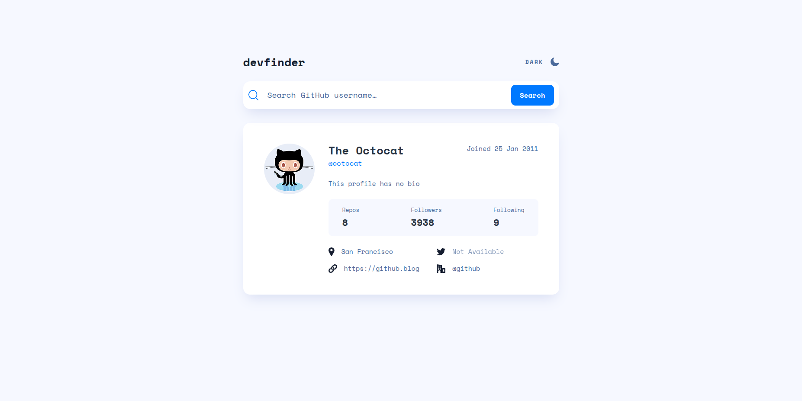

# GitHub User Search App

A responsive GitHub profile search application built with vanilla JavaScript, SCSS, Vite, and the GitHub REST API.
Search for a GitHub username to view profile details, repository statistics, and contact links. The interface also
supports light and dark themes.



## Table of contents

- [Overview](#overview)
  - [The challenge](#the-challenge)
  - [Features](#features)
  - [Links](#links)
- [My process](#my-process)
  - [Built with](#built-with)
  - [Project structure](#project-structure)
  - [What I learned](#what-i-learned)
  - [Continued development](#continued-development)
  - [Useful resources](#useful-resources)
  - [AI collaboration](#ai-collaboration)
- [Getting started](#getting-started)
- [Author](#author)
- [Acknowledgments](#acknowledgments)

## Overview

### The challenge

This project is a solution to
the [Frontend Mentor GitHub user search app challenge](https://www.frontendmentor.io/challenges/github-user-search-app-Q09YOgaH6).

The goal was to build an interface that allows users to search for GitHub accounts and view the information returned by
the GitHub Users API.

### Features

- Search for GitHub users by username.
- Display a user's avatar, name, username, join date, bio, repository count, followers, and following.
- Display location, website, X (Twitter), and company information when available.
- Show a fallback message when optional profile information is missing.
- Display an error state when a user cannot be found or the request fails.
- Toggle between light and dark themes.
- Detect the operating system's preferred color scheme on the first visit.
- Save the selected theme in `localStorage` so it is restored on subsequent visits.
- Responsive layout with interactive hover states.

### Links

- **Frontend Mentor
  challenge:** [GitHub user search app](https://www.frontendmentor.io/challenges/github-user-search-app-Q09YOgaH6)
- **Solution URL:** [GitHub Repo](https://github.com/runny-life/github-user-search-app)
- **Live site URL:** [GitHub Pages](https://runny-life.github.io/github-user-search-app/).

## My process

### Built with

- Semantic HTML5
- SCSS (Sass)
- CSS custom properties and SCSS variables
- Flexbox and CSS Grid
- Responsive, mobile-first styling
- Vanilla JavaScript (ES modules and classes)
- [GitHub REST API](https://docs.github.com/en/rest/users/users)
- [Octokit](https://github.com/octokit/octokit.js) for API requests
- [Vite](https://vite.dev/) for development and production builds
- [Prettier](https://prettier.io/) for code formatting
- [Husky](https://typicode.github.io/husky/) and lint-staged for pre-commit formatting

### Project structure

The application code is organized by responsibility:

```text
src/
├── assets/
│   ├── fonts/
│   └── image/
├── scripts/
│   ├── api/
│   │   └── github-api.js
│   ├── controllers/
│   │   └── profile-search.js
│   ├── ui/
│   │   ├── profile-card.js
│   │   └── theme-toggle.js
│   └── main.js
└── styles/
    ├── abstracts/
    ├── base/
    ├── components/
    ├── layout/
    ├── theme/
    └── style.scss
```

- **`api/`** contains the `GithubApi` class, which communicates with the GitHub API through Octokit.
- **`controllers/`** contains the `ProfileSearch` class, which handles form submission, loading state, and search
  errors.
- **`ui/`** contains the classes responsible for rendering profile information and controlling the theme.
- **`styles/`** separates shared design tools, base styles, components, layout, and theme definitions.

### What I learned

- **Separating responsibilities:** Splitting API communication, search-flow logic, and DOM updates into separate classes
  makes the code easier to understand and maintain.
- **Working with an external API:** I used Octokit to request user data from the GitHub REST API and render the returned
  information.
- **Handling optional API fields:** Profile properties such as the bio, location, website, social account, and company
  may be empty. The UI handles missing values with appropriate fallback text and disabled links.
- **Managing themes:** The theme controller checks for a previously saved preference, falls back to the system
  color-scheme preference, and stores manual theme changes in `localStorage`.
- **Formatting dates:** `Intl.DateTimeFormat` converts the API's date value into a readable join date.
- **Organizing SCSS:** Styles are split into focused files for the base layer, layout, components, and theme, while
  shared variables and mixins help keep styling consistent.

### Continued development

In future projects, I would like to focus on:

- Improving accessibility, including clearer status announcements and more detailed handling of form and API errors.
- Adding more explicit loading feedback during API requests.
- Reviewing edge cases such as network failures and GitHub API rate limits.
- Expanding the application's test coverage.
- Continuing to improve the structure and maintainability of JavaScript modules and SCSS.

### Useful resources

- [GitHub REST API — Users](https://docs.github.com/en/rest/users/users) — API reference for retrieving public GitHub
  user profiles.
- [Octokit.js documentation](https://github.com/octokit/octokit.js) — Documentation for the JavaScript GitHub client
  used to make API requests.
- [MDN — Using the Fetch API](https://developer.mozilla.org/en-US/docs/Web/API/Fetch_API) — Useful background on making
  HTTP requests in JavaScript.
- [MDN — `localStorage`](https://developer.mozilla.org/en-US/docs/Web/API/Window/localStorage) — Reference for storing
  the selected theme in the browser.
- [MDN — `prefers-color-scheme`](https://developer.mozilla.org/en-US/docs/Web/CSS/@media/prefers-color-scheme) —
  Reference for detecting the user's system color-scheme preference.
- [Sass documentation](https://sass-lang.com/documentation/) — Reference for SCSS features and project styling.
- [Vite documentation](https://vite.dev/guide/) — Guide to the development server and production build.

### AI collaboration

ChatGPT was used to help prepare and structure this README. The application code and implementation are documented based
on the project files.

## Getting started

### Prerequisites

- [Node.js](https://nodejs.org/) (a current LTS version is recommended)
- npm

### Installation

1. Clone the repository:

   ```bash
   git clone <your-repository-url>
   ```

2. Move into the project directory:

   ```bash
   cd github-user-search-app
   ```

3. Install dependencies:

   ```bash
   npm install
   ```

4. Start the development server:

   ```bash
   npm run dev
   ```

5. Open the local URL printed by Vite in your terminal.

### Available scripts

| Command             | Description                                                     |
| ------------------- | --------------------------------------------------------------- |
| `npm run dev`       | Starts the Vite development server.                             |
| `npm run build`     | Creates an optimized production build in the `dist/` directory. |
| `npm run preview`   | Serves the production build locally for preview.                |
| `npm run formatter` | Runs Prettier across the project.                               |

## Author

- **Frontend Mentor:** [Frontend Mentor profile](https://www.frontendmentor.io/profile/runny-life).
- **GitHub:** [GitHub profile](https://github.com/runny-life).

## Acknowledgments

- [Frontend Mentor](https://www.frontendmentor.io/) for the challenge and design.
- [GitHub](https://github.com/) for providing the REST API used to retrieve public profile information.
